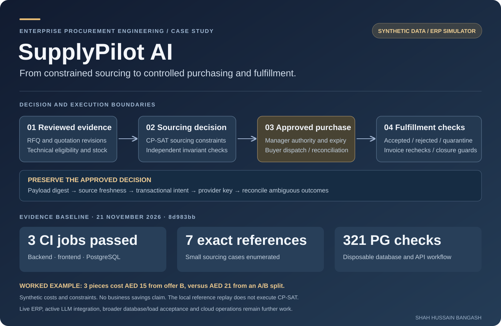
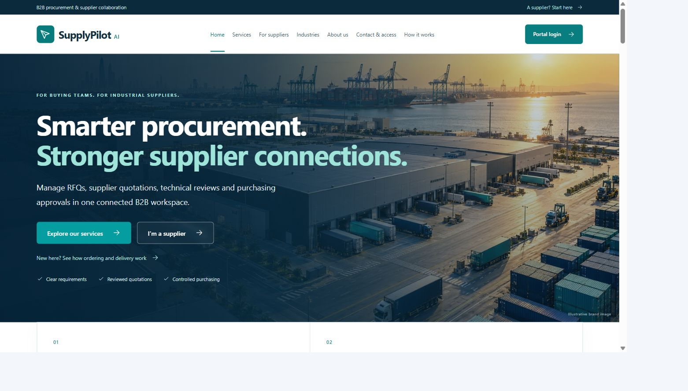
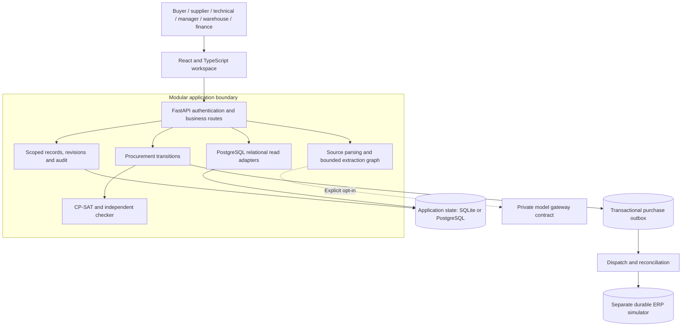
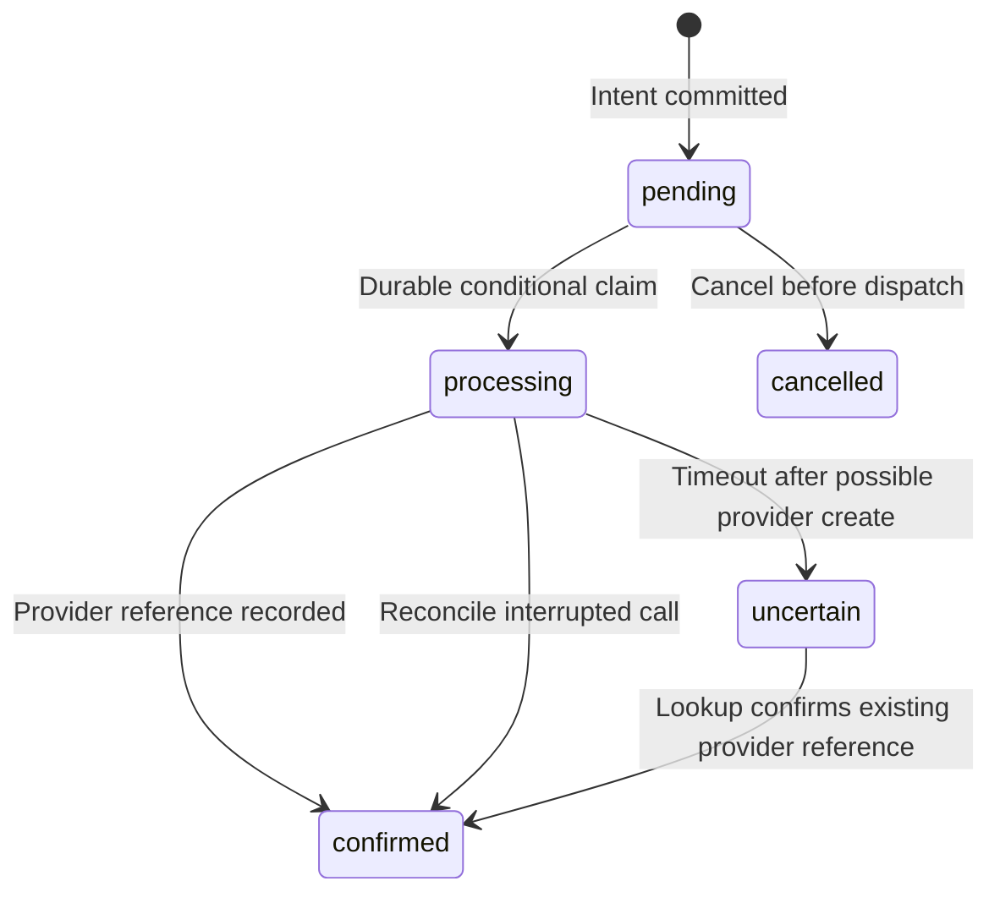

# SupplyPilot AI Case Study

## Architecting controlled procurement from sourcing decisions to purchasing and fulfillment



**Enterprise solution architecture · Constrained optimization · Governed AI integration · Procurement workflows · Security and governance · Infrastructure design · Software engineering · Applied research**

| Project | At a glance |
|---|---|
| Project owner | Shah Hussain Bangash · [GitHub](https://github.com/shah-hussain-bangash) |
| Business domain | Industrial-material procurement and supplier collaboration |
| Historical source baseline | [`8d983bb`, main, 21 November 2026][baseline] |
| Application | React / TypeScript / Vite, FastAPI / Python and SQLAlchemy |
| Decision and processing engines | OR-Tools CP-SAT and a bounded deterministic LangGraph extraction pipeline |
| Historical persistence baseline | SQLite demonstration; PostgreSQL migration chain through `0007_proc_fulfillment`, with tenant RLS and synchronized relational reads |
| External execution | Durable local ERP simulator; live purchasing integrations remain further work |
| Historical hosted evidence | [CI run 44882883031][ci]: backend tests, frontend typecheck/build and PostgreSQL acceptance jobs all successful; 321 named PostgreSQL checks passed |

**Start here:** [Three-minute merged architecture example](#three-minute-merged-architecture-example), reproduced from `11b6204` on 24 November 2026. The original narrative and its pinned 21 November evidence remain historical; the update below separates current reproduction from those earlier claims.

**The architectural contribution:** SupplyPilot connects source evidence, reviewed requirements, technical eligibility, constrained sourcing, exact-payload approval, transactional purchase intent, uncertain-outcome reconciliation, receiving and invoice rechecks. The main engineering challenge is preserving the meaning and authority of a decision as its inputs and operational state change.

[Business problem](#1-business-problem-and-objectives) · [Architecture](#3-solution-architecture) · [Optimization](#4-sourcing-optimization-and-independent-checking) · [Controlled purchasing](#5-approval-execution-and-uncertain-outcomes) · [Security](#8-security-and-governance) · [Evidence](#10-engineering-evidence-and-reproducibility) · [Walkthrough](#12-technical-walkthrough-and-next-delivery-gates)

### Application view



*Captured from the running local public website on 21 November 2026. The image shows the current buyer/supplier entry points and service positioning; the logistics photograph is illustrative brand imagery. This is an interface record, not evidence of a live purchasing integration or production deployment.*

## 1. Business problem and objectives

A buyer must do more than select the lowest quoted unit price. Available stock, reserved stock, confirmed inbound supply, technical requirements, certificates, supplier capacity, minimum order quantities, pack sizes, delivery dates and freight can change the preferred allocation. An approved plan can also become stale before a purchase is dispatched.

After purchase creation, a physical receipt can contain accepted, rejected and quarantined quantities. An invoice may arrive before sufficient material is accepted, or may repeat quantities already matched. Treating all these events as a single “completed” status hides important obligations.

SupplyPilot models procurement as a sequence of decisions with separate authority and evidence boundaries:

| Objective | Implemented response | Business measure for a future pilot |
|---|---|---|
| Produce feasible sourcing choices | Integer optimization plus independent plan checks | Feasibility rate, modeled cost and comparison with a defined buyer baseline |
| Preserve the approved decision | Frozen payload, source revisions, evidence hashes, expiry and authority checks | Stale/tampered decision rejection and approval turnaround |
| Avoid blind repeat purchases | Durable intent, provider idempotency and reconciliation | Observed duplicate effects and uncertain-operation resolution time |
| Keep fulfillment obligations visible | Separate receipt dispositions, invoice checks and closure guards | Match exception rate, unresolved obligations and time to close |
| Protect collaboration boundaries | Authenticated roles, tenant scope and supplier-specific visibility | Denied-access results across an approved access matrix |

These are proposed outcome measures. Actual procurement savings, reduced working capital, staffing savings and production service levels have not been measured by the synthetic application.

## 2. End-to-end procurement workflow


RFQ means request for quotation. An invitation grants supplier access in the portal; it does not send email. Supplier-submitted quotations require current technical assessment before they become eligible for planning. Procurement execution remains separate from extraction and optimization.

The application distinguishes the buyer, technical reviewer, manager, supplier, warehouse and finance responsibilities. Internal visibility is currently tenant-wide rather than category/site/entity-specific. The source and tests make the workflow reviewable with fictional records and a simulated external system.

## 3. Solution architecture



*Logical source responsibilities. The optional model gateway is not an active verified model deployment, and the ERP box is a local simulator.*

The [architecture decisions][architecture] select a modular monolith: one application boundary with separate responsibilities for identity, domain state, procurement, planning, extraction and integration. This keeps transactions and source-to-test traces understandable while the business rules are still evolving.

The frontend is built into static assets that the API can serve. Core writes use SQLAlchemy transactions and revision checks. The provider simulator persists its own purchase state in a separate SQLite database, creating a real distinction between application state and simulated external truth.

| Architecture area | Source to inspect |
|---|---|
| Identity and permission checks | [`security.py`][security-code] and API routes |
| Scoped records, compare-and-swap revisions and audit | [`domain.py`][domain] |
| RFQ, quotation, approval, receiving and invoice transitions | [`procurement.py`][procurement] |
| Sourcing formulation and independent invariants | [`planning.py`][planning] |
| Purchase posting and ambiguous outcomes | [`integrations.py`][integration] |
| Gradual PostgreSQL read migration | [`relational_reads.py`][reads] and migrations |
| Bounded extraction, lexical search and forecast baselines | [`intelligence.py`][intelligence] |

## 4. Sourcing optimization and independent checking

### Translate business constraints into an integer model

For each requirement, availability is derived from usable stock minus reservations plus confirmed inbound due by the requirement date, bounded below by zero. Stock snapshots older than one hour are rejected. The remaining shortage becomes the exact quantity to source.

Each eligible offer has an integer quantity `q`, Boolean selection variable `y`, and integer number of packs. Eligibility requires current technical compliance, quote validity and delivery by the requirement date. The model enforces:

- Allocated pieces equal the shortage for each SKU.
- Quantity stays within the offer capacity and is zero when the offer is not selected.
- Selected offers meet their minimum order quantity.
- Quantities are multiples of the offer's pack size.
- The modeled total stays within budget.

The cost objective is:

`sum(quantity × (unit price + per-piece freight) + selected-offer fixed freight)`

Costs are converted to integer cents for CP-SAT. Google's [solver documentation][ortools-doc] explains its integer formulation and the distinction between `OPTIMAL`, `FEASIBLE`, `INFEASIBLE` and other result states.

SupplyPilot limits eligible offers to 600 and uses a five-second limit per solve with one search worker. It retains the returned status and best objective bound. A feasible result is useful, but does not prove global optimality.

The delivery scenario first minimizes quantity-weighted delivery ordinal, then minimizes cost within the best delivery bound found. It does not minimize the latest arrival date or model a distribution of uncertain delivery times. A timed-out first stage can leave delivery optimality unproven even if the second cost stage is optimal within its restricted search space.

### Why a higher unit price can produce the cheaper plan

The committed [solver tests][solver-tests] define a small exact-reference fixture:

| Offer | Capacity | Unit price AED | Fixed freight AED | Pack size | Minimum quantity |
|---|---:|---:|---:|---:|---:|
| A | 8 | 4.00 | 8.00 | 2 | 2 |
| B | 10 | 5.00 | 0.00 | 1 | 1 |

For a three-piece shortage, buying two pieces from A and one from B costs **AED 21.00**. Buying all three from B costs **AED 15.00**. Fixed freight changes the preferred decision despite B's higher unit price.

An independent local enumeration of the same small formulation on 21 November produced:

| Required pieces | Minimum modeled cost AED |
|---:|---:|
| 3 | 15.00 |
| 5 | 25.00 |
| 8 | 40.00 |
| 9 | 45.00 |
| 10 | 50.00 |
| 12 | 60.00 |
| 15 | 75.00 |

Some cases have tied allocations. Changing both suppliers to even pack sizes makes an exact five-piece purchase infeasible. The [reference record][reference] preserves all minimizing allocations and assumptions; the [script][reference-script] reproduces them using the standard library. This calculation does not rerun CP-SAT or establish real procurement savings.

### Check the result independently

`check_plan` recomputes current shortages, source equality, offer revisions, technical eligibility, dates, capacity, pack/MOQ constraints, line totals and budget. The system then adds evidence hashes to the frozen plan. A solver output is therefore subject to business invariants before it becomes an approval candidate.

The independent checker verifies feasibility and consistency, not global optimality. The small exhaustive-reference tests provide an additional exact comparison for their limited fixture space.

### Model limitations matter commercially

Fixed freight applies per selected offer, not per consolidated supplier shipment. Capacity is represented per offer; shared supplier-wide constraints are not established. The current model uses AED and integer pieces, not arbitrary currency conversion or weight/length units. Tax accounting, freight consolidation, quality costs, inventory-service targets and multi-echelon network planning remain outside the formulation.

## 5. Approval, execution and uncertain outcomes

### Bind approval to a specific decision

The plan freezes requirement and offer revisions, stock references, commercial fields, evidence hashes and a payload digest. A manager can decide only on a pending plan, cannot approve a plan they created, and must have sufficient configured authority. The current implementation records a 24-hour expiry; an institution would need to approve its own authority and expiry policy.

A buyer creates the execution intent only after approval, digest and freshness checks. Within the same application transaction, the system records the intent, reserves internal stock, consumes quoted capacity, updates the plan and appends audit events. Reusing the same tenant/key for the same plan and digest returns the prior intent; conflicting reuse is rejected.

### Revalidate at dispatch

Approval can be valid when queued and invalid later. Before claiming a pending intent, dispatch checks the approved payload, RFQ revision, current approver status/role/authority, expiry, stock freshness, quote validity, technical eligibility and source hashes. Selected quoted facts are compared with the frozen allocation.

The [dispatch tests][dispatch-tests] cover expiry, locked queued requirements, revoked technical proof and cancellation boundaries. A never-dispatched intent may be cancelled locally with reservation/capacity release and plan supersession. A possible external effect requires reconciliation instead.

### Make ambiguity an explicit operational state



*Simplified execution states. A failed reconciliation lookup leaves the operation blocked for manual evidence.*

The simulator creates a durable provider order under a tenant-scoped unique key. Its timeout mode commits that order and then raises a timeout, reproducing an important ambiguous-result case. A repeat ordinary dispatch is blocked for processing/uncertain intents; reconciliation looks up the existing provider reference rather than blindly creating another order.

Tests cover payload tampering, timeout/reconciliation and repeat confirmed dispatch. This demonstrates the selected algorithmic boundary against the simulator. Real ERP integration must establish its own idempotency, partial-posting, lookup-consistency and reconciliation semantics. Exactly-once execution across arbitrary providers is not claimed.

## 6. Receiving, invoice rechecks and closure

Warehouse receiving records accepted, rejected and quarantined quantities separately and prevents receipt beyond the remaining order quantity. Accepted units increase usable stock; quarantined units remain separate. Quality exceptions are created when needed.

Finance matches invoice quantity against accepted quantity less quantities already matched to prior invoices, and checks the material unit price exactly. Supplier invoice numbers are deduplicated within tenant/supplier scope. Freight/tax accounting and payment execution remain deferred.

### Recheck the same invoice when evidence changes

An invoice that arrives before sufficient accepted receipt can initially mismatch. After warehouse evidence is recorded, finance can recheck the same invoice with current invoice and order revisions. The service retains prior assessment history rather than creating a replacement invoice or rewriting its commercial facts.

The [invoice-recheck tests][invoice-tests] verify that a recheck does not waive price or accepted-quantity requirements, counts previously matched quantities, enforces role/tenant boundaries and rejects stale revisions. A successful recheck resolves the specifically generated matching exception while preserving unrelated manual investigations.

Order closure requires fully accepted quantities, fully matched material invoices and no relevant open order/invoice exceptions. Merely marking an exception resolved does not rewrite a receipt disposition or make an invoice match. Returns, quality release, posted-order amendments and credit/reversal workflows require further controlled transaction design.

## 7. Data architecture and PostgreSQL migration

The application began with typed JSON aggregates in `records`. Current writes still use that aggregate transaction path. PostgreSQL migrations progressively add synchronized supplier, RFQ, offer, order, receipt and invoice projections with relational columns, constraints and tenant-aware references.

Trigger functions update projections in the same transaction as source records. Runtime access to those projection tables is read-only. The read adapters preserve API identity, history and extension fields while sourcing normalized fields from the corresponding relations.

A projection's `source_revision` must match the aggregate revision. Missing/stale projections return a `503 projection_not_ready` condition rather than silently serving old values. The [order-read tests][order-tests] and [fulfillment-read tests][fulfillment-tests] exercise adapter mappings and stale/missing-row behavior with fabricated query rows; they are not PostgreSQL engine integration tests.

The latest [PostgreSQL acceptance runner][pg-runner] also exercises real relational reads, tenant/supplier denial, stale projections and the receipt-to-invoice workflow in a disposable database. It exposed a collection/detail timestamp-format discrepancy, and the merged fix normalizes both representations to the same ISO-format contract. The hosted run includes fractional-second regression probes for orders, receipts and invoices.

This gradual migration reduces the scope of a single cutover, but introduces synchronization and migration complexity. It is not a completed move to a fully normalized command model. The inspected migration chain reaches [`0007_proc_fulfillment`][migration7]; some earlier reference documents describe superseded milestones and must be read in that context.

## 8. Security and governance

| Boundary | Mechanism in source | Remaining assurance |
|---|---|---|
| User identity | Salted PBKDF2 password hashes, expiring local JWTs; optional RS256 OIDC verification mapped to preprovisioned users | Live IdP acceptance, provisioning, revocation and distributed abuse protection |
| Tenant separation | Tenant-filtered queries, transaction-local tenant binding and forced PostgreSQL RLS policies | Selected real PostgreSQL denials pass in disposable CI; target-environment and broader adversarial assessment remain |
| Supplier collaboration | Own offer/document scope and invited RFQs; internal RFQ fields removed from supplier views | Complete institution-specific visibility and access matrix |
| Business authority | Separate buyer, technical, manager, warehouse and finance actions; approval limits and digest checks | Approved delegation, emergency access and organizational authority policies |
| Concurrent changes | Record revisions, compare-and-swap writes and selected row locks | Representative concurrent PostgreSQL workload and fault testing |
| Source intake | Bounded supported text/PDF parsing, quarantine and authenticated source access | Antivirus, isolated parser, managed private storage and retention |
| Audit | Server actor/time, revision events and runtime grant restrictions | External protected retention and independent control assessment |

The [tenant-isolation design][tenant] and [RLS migration][rls] use `USING`/`WITH CHECK` policies with transaction-local `supplypilot.tenant`. Tenant switching in an ORM session is prohibited. The application resolves identity before binding the tenant; it does not accept a caller's tenant header as authority.

This design assumes trusted application code. A holder of the shared runtime database credential can set the custom tenant value; the policy is not protection from arbitrary SQL execution or credential compromise. PostgreSQL's [official row-security documentation][postgres-doc] also distinguishes normal policies from privileged roles that can bypass them.

For a UAE enterprise pilot, data classification, residency, supplier-data permissions, retention and legal/compliance applicability need named institutional owners. The repository does not establish a regulatory approval or security certification.

## 9. AI, agentic processing and research boundaries

### Use the appropriate engine for each decision

The [extraction graph][intelligence] is a real LangGraph pipeline with deterministic text-candidate extraction and review flags. It records page and text-offset anchors. It is synchronous and bounded, does not implement OCR, and has no purchasing tools or approval authority.

Search is a tenant-filtered lexical overlap baseline returning quotations, not a deployed embedding/RAG answer service. Forecasting compares a rolling four-observation mean with a naive baseline using earlier observations. Its residual range is explicitly heuristic rather than a calibrated confidence interval, and no trained production forecasting model is claimed.

### Make model integration opt-in and reviewable

The [private model gateway][gateway] is disabled unless explicitly configured. Its contract uses HTTPS, a fixed extraction task, bounded input and structured candidate output. Source quotes must occur on their cited page; accepted candidates remain unreviewed and require human review.

An exact quote does not prove that a suggested value is correct or belongs to the right field. The gateway cannot change procurement records or invoke business tools. No active live LLM, semantic embedding deployment, model-quality benchmark or governed model-release pipeline is established by the inspected source.

### Proposed research sequence

| Research question | Study | Evidence needed |
|---|---|---|
| Does optimization improve a realistic buyer baseline? | Paired scenarios using approved costs and constraints | Feasibility, objective gap, time, stability and explicit baseline behavior |
| How robust is sourcing under uncertain supply? | Backtests with held-out lead times/capacity scenarios | Service/cost trade-offs and calibrated uncertainty |
| Which document fields can be assisted reliably? | Frozen permissioned corpus with independent labels | Exact field match, citation correctness, abstention and review effort |
| Is a model useful beyond deterministic extraction? | Compare rules, model candidates and reviewed outcomes | Added correct fields, false suggestions, latency and cost |
| Could bounded agents help investigate exceptions? | Read-only evidence assembly before any action pilot | Source support, access controls, budget limits and reviewer acceptance |

The advanced contribution is choosing where deterministic rules, mathematical optimization, model suggestions and human decisions belong. A graph framework alone does not establish autonomous agent capabilities, and a solver fixture does not demonstrate business improvement.

## 10. Engineering evidence and reproducibility

The [21 November 2026 hosted run][ci] completed all three jobs successfully for the pinned application revision.

| Evidence | Verified outcome | Scope |
|---|---|---|
| Backend tests job | Successful `python -m pytest -q` execution | Isolated SQLite-backed application tests and unit/adapter checks; real PostgreSQL runs in its separate acceptance job |
| Frontend job | Successful locked install, TypeScript check and Vite production build | Build/type evidence; the job does not run Playwright browser scripts |
| PostgreSQL migrations and workflow | **321 named checks passed** in a new PostgreSQL 17 container | Fresh migration chain, restricted runtime role, forced RLS, protected grants, API procurement, relational parity and controlled read probes |
| Exact solver-reference tests | Seven parametrized demands compared with exhaustive enumeration; separate infeasible-pack fixture in source | Small deterministic formulation, not a production optimization benchmark |
| Execution and integrity tests | Source covers stale approval, tampering, timeout, reconciliation, duplicate dispatch and revision conflicts | Synthetic application/provider behavior |
| Invoice recheck tests | Source covers matching history, cumulative quantities, unchanged mismatches and access/revision checks | Synthetic finance/warehouse workflow |
| Local reference enumeration | Seven cost minima reproduced, tied minima retained, even-pack infeasibility reproduced | Standard-library calculation only; CP-SAT/application not rerun locally |

The backend's configured and command-line quiet options suppress its usual summary line. The inspected output contains successful progress markers through 100%; this case study reports the job result rather than presenting an independently counted coverage percentage.

The PostgreSQL job applies all seven migrations and verifies forced RLS on 13 tenant tables, denial without tenant context, read-only projection grants and protected audit/migration tables. It then creates an AED 7,250 synthetic purchase, reconciles a simulated timeout, records 55 accepted pieces, rechecks the original mismatched invoice and closes the fully matched order. Controlled projection probes are restored, with row hashes compared afterward.

The 321 checks are assertions in an acceptance script, not 321 pytest cases or an independent security certification. This job uses Docker to run PostgreSQL; it does not build or validate the application container. Historical backup/restore rehearsals remain separate. Browser, concurrent load, live ERP, live models, production identity and cloud operations remain outside this run.

The [reference JSON][reference] and [reproduction script][reference-script] preserve the worked optimization assumptions separately from hosted test evidence. The production-readiness conclusion must depend on its own environment, data, controls and acceptance records.

## 11. Infrastructure and operating design

The repository contains a multistage [Dockerfile][docker] that builds the frontend and runs the Python application as a non-root user. [Compose][compose] describes local PostgreSQL, Redis, the application and optional Celery worker/scheduler profiles. These are local deployment assets, not evidence that a managed cloud architecture has been deployed.

The Compose path should not be assumed to provision the dedicated runtime/migration roles or all current PostgreSQL controls. The explicit development launcher and Alembic procedure require separate configuration and verification.

| Operating concern | Existing foundation | Next acceptance evidence |
|---|---|---|
| Delivery | Backend CI and frontend build | Immutable image, dependency/security review, container smoke and environment promotion |
| Persistence | Aggregate transactions, migrations, projections and passing fresh PostgreSQL/RLS acceptance | Populated-database upgrades, broader concurrency, rollback constraints and target-environment acceptance |
| Recovery | Durable intent/provider distinction and reconciliation runbook | Restore application DB, original documents and provider mappings together; reconcile before replay |
| Observability | Request IDs, API timing/logging and audit events | Queue age, uncertain-operation age, failure rates and alert ownership |
| Identity and secrets | Local auth and optional OIDC contract | Approved IdP, secret storage/rotation and workload identity |
| Performance and cost | Bounded solver and explicit model opt-in | Concurrent workload, solver feasibility/gap distribution, storage and cost per fulfilled order |

The [runbooks][runbooks] correctly treat provider effects as surviving a database rollback. Restoring only the application database can otherwise cause the application to forget a purchase that the external system still holds. Restore validation must reconcile external intents before execution resumes.

A future cloud pilot should record exact source/image/configuration revisions, network and storage boundaries, identity, data permissions, load, cost and restoration outcomes. No production availability, recovery-time objective or monthly cloud cost is established here.

## 12. Technical walkthrough and next delivery gates

### Three-minute merged architecture example

Tested source: [`11b6204` on main](https://github.com/shah-hussain-bangash/SupplyPilot-AI/commit/11b6204b3d7fcc50941e7c1d67d392cc62bac76e), including merged [PR #16](https://github.com/shah-hussain-bangash/SupplyPilot-AI/pull/16). [Reproduction evidence](evidence/procurement-demo-2026-11-24.json) records scope and limitations.

| Time | Show and explain |
|---|---|
| 0:00–1:00 · Business flow | In the fresh synthetic seed, technical staff review Gulf and Desert quotes. Buyer saves the AED 7,250 sourcing plan: 30 Gulf pieces at AED 120 + AED 5 freight, and 25 Desert pieces at AED 128 + AED 12 freight. A separate manager approves its exact payload. Buyer queues it, simulates a provider timeout, then reconciles the same intent to one confirmed simulator purchase. |
| 1:00–2:00 · Persistence decision | `records` remains the authoritative aggregate write path. Migration-owned triggers synchronize procurement projections inside the same transaction; read adapters retain API identity/history while using normalized fields. Outbox intent, audit, reservations and quote consumption commit together. An uncertain provider effect is reconciled, not blindly purchased again. `0011` adds document metadata and ordered parsed pages; uploaded file bytes stay on their existing path. |
| 2:00–3:00 · Isolation and recovery | Open the [fresh PostgreSQL job](https://github.com/shah-hussain-bangash/SupplyPilot-AI/actions/runs/45172664175/job/138231976243): no tenant context hides rows, another tenant cannot see the purchase, runtime projections are read-only, and dump/restore checks preserve rows, definitions and restored permissions. Close the browser example at 55 accepted pieces, two matched material invoices and AED 7,250. These are synthetic controls and outcomes, not measured savings or production recovery certification. |

**Reproduce from a clean disposable checkout** at the pinned revision (setup is outside the three-minute narration). Use Python with `backend/requirements.txt` installed and Node/npm for the browser runner:

```powershell
git switch --detach 11b6204b3d7fcc50941e7c1d67d392cc62bac76e
python scripts/test_browser.py --prepare --output test-results/architecture-demo
python scripts/test_postgres.py --docker --concurrency --restore-check --report test-results/postgresql-demo.json
```

The browser command creates a fresh temporary SQLite database, synthetic accounts and loopback server; it removes the server and temporary data afterward. Its report and closed-order screenshot remain under `test-results/architecture-demo`. The PostgreSQL command creates and removes its own PostgreSQL 17 container with random credentials and port, and restores a dump into a second disposable database. Neither command accepts the working development database as its target. Reproduction creates new order IDs; it does not reopen the existing development order.

**Observed:** the local real-browser/API run passed 27 checks. The [hosted PostgreSQL rerun, attempt 2](https://github.com/shah-hussain-bangash/SupplyPilot-AI/actions/runs/45172664175/attempts/2), passed on `11b6204`. The historical **957 PostgreSQL checks** belong to the original [PR #16 CI run](https://github.com/shah-hussain-bangash/SupplyPilot-AI/actions/runs/45171318136/job/137681289893), tested at [`0bc9865`](https://github.com/shah-hussain-bangash/SupplyPilot-AI/commit/0bc986558e8a0f5eb7ec925f2d4362fb1f48e39e); that count is not a new certification or pytest count.

**Limits and dependency:** local Docker access was denied at `npipe:////./pipe/docker_engine`, so the connected hosted PostgreSQL job supplied the fresh database evidence. The main merge run still reports a browser failure from attempt 1 (receipt-row locator timeout); the local walkthrough passed without reproducing it. This update does not claim an all-green main workflow or fix an unconfirmed product regression. Browser SQLite coverage and PostgreSQL integration coverage remain separate. Restore reuses roles in one disposable cluster and does not restore uploaded files or external provider state. Live ERP, email and payments remain disconnected.

**Browser-test follow-up ([PR #17](https://github.com/shah-hussain-bangash/SupplyPilot-AI/pull/17)):** the initial PR run also read invoice revision 1 just after a successful revision 2 recheck. Its acceptance helper now waits for the saved mutation response to be rendered and checks the inspected record ID/revision. Application code is unchanged. The revised helper passed 27 local browser checks normally and 27 with real invoice-list requests delayed by 400 ms. Use PR #17's reviewed head (`gh pr checkout 17` in a disposable checkout) to exercise this follow-up; the commands above intentionally retain the original pinned baseline. Historical run failures remain visible in the evidence record.

A ten-minute demonstration can connect business judgment to executable engineering:

1. **Requirements and evidence:** open a synthetic RFQ and show its reviewed revision and source material.
2. **Supplier eligibility:** explain a quote revision, certificate assessment and why unknown/noncompliant offers are excluded.
3. **Optimization:** demonstrate the fixed-freight example, solver status/bound and independent checker.
4. **Approval and execution:** approve as a distinct manager, queue as buyer, then show expiry or changed-proof rejection at dispatch.
5. **Ambiguous outcome:** simulate acceptance followed by timeout, demonstrate blocked ordinary redispatch and reconcile the same provider reference.
6. **Fulfillment:** record partial accepted/quarantined quantities, recheck a mismatched invoice and show a remaining closure obligation.
7. **Engineering evidence:** open the pinned CI run and explain the next PostgreSQL, ERP and cloud gate.

| Priority gate | Completion evidence |
|---|---|
| Extend database assurance | Populated-database upgrade, representative concurrency, restore and broader policy tests beyond the passing disposable CI baseline |
| Real ERP sandbox contract | Authorized provider references, duplicate/timeout/partial-posting tests and reconciliation procedure |
| Document/AI evaluation | Representative labeled sources, field/citation errors, access tests and human review outcomes |
| Operational release exercise | Container/deployment record, load and security checks, cost and isolated restore/reconciliation |
| Measured business pilot | Approved buyer baseline, representative cases, review effort, exceptions and realized outcomes |

SupplyPilot demonstrates how sourcing mathematics and software controls can share one traceable workflow. Its strongest architecture story is the continuity from evidence and constraint validation to exact approval, guarded execution and preserved fulfillment obligations.

---

**Evidence reviewed:** 21 November 2026. Source statements refer to the pinned baseline. Reference documents describe multiple development milestones; source and dated execution evidence define the current claim boundaries.

[baseline]: https://github.com/zenithdevelopers7-source/SupplyPilot-AI/commit/8d983bb07fd640bd4c548dff09f28f837992e6d4
[ci]: https://github.com/zenithdevelopers7-source/SupplyPilot-AI/actions/runs/44882883031
[architecture]: https://github.com/zenithdevelopers7-source/SupplyPilot-AI/blob/8d983bb07fd640bd4c548dff09f28f837992e6d4/docs/reference/ARCHITECTURE.md
[security-code]: https://github.com/zenithdevelopers7-source/SupplyPilot-AI/blob/8d983bb07fd640bd4c548dff09f28f837992e6d4/backend/supplypilot/security.py
[domain]: https://github.com/zenithdevelopers7-source/SupplyPilot-AI/blob/8d983bb07fd640bd4c548dff09f28f837992e6d4/backend/supplypilot/domain.py
[procurement]: https://github.com/zenithdevelopers7-source/SupplyPilot-AI/blob/8d983bb07fd640bd4c548dff09f28f837992e6d4/backend/supplypilot/procurement.py
[planning]: https://github.com/zenithdevelopers7-source/SupplyPilot-AI/blob/8d983bb07fd640bd4c548dff09f28f837992e6d4/backend/supplypilot/planning.py
[integration]: https://github.com/zenithdevelopers7-source/SupplyPilot-AI/blob/8d983bb07fd640bd4c548dff09f28f837992e6d4/backend/supplypilot/integrations.py
[reads]: https://github.com/zenithdevelopers7-source/SupplyPilot-AI/blob/8d983bb07fd640bd4c548dff09f28f837992e6d4/backend/supplypilot/relational_reads.py
[intelligence]: https://github.com/zenithdevelopers7-source/SupplyPilot-AI/blob/8d983bb07fd640bd4c548dff09f28f837992e6d4/backend/supplypilot/intelligence.py
[solver-tests]: https://github.com/zenithdevelopers7-source/SupplyPilot-AI/blob/8d983bb07fd640bd4c548dff09f28f837992e6d4/backend/tests/test_solver.py
[dispatch-tests]: https://github.com/zenithdevelopers7-source/SupplyPilot-AI/blob/8d983bb07fd640bd4c548dff09f28f837992e6d4/backend/tests/test_dispatch_boundary.py
[invoice-tests]: https://github.com/zenithdevelopers7-source/SupplyPilot-AI/blob/8d983bb07fd640bd4c548dff09f28f837992e6d4/backend/tests/test_invoice_recheck.py
[order-tests]: https://github.com/zenithdevelopers7-source/SupplyPilot-AI/blob/8d983bb07fd640bd4c548dff09f28f837992e6d4/backend/tests/test_order_relational_reads.py
[fulfillment-tests]: https://github.com/zenithdevelopers7-source/SupplyPilot-AI/blob/8d983bb07fd640bd4c548dff09f28f837992e6d4/backend/tests/test_fulfillment_relational_reads.py
[migration7]: https://github.com/zenithdevelopers7-source/SupplyPilot-AI/blob/8d983bb07fd640bd4c548dff09f28f837992e6d4/backend/migrations/versions/0007_proc_fulfillment.py
[tenant]: https://github.com/zenithdevelopers7-source/SupplyPilot-AI/blob/8d983bb07fd640bd4c548dff09f28f837992e6d4/docs/reference/TENANT_ISOLATION.md
[rls]: https://github.com/zenithdevelopers7-source/SupplyPilot-AI/blob/8d983bb07fd640bd4c548dff09f28f837992e6d4/backend/migrations/versions/0002_tenant_rls.py
[gateway]: https://github.com/zenithdevelopers7-source/SupplyPilot-AI/blob/8d983bb07fd640bd4c548dff09f28f837992e6d4/backend/supplypilot/model_gateway.py
[docker]: https://github.com/zenithdevelopers7-source/SupplyPilot-AI/blob/8d983bb07fd640bd4c548dff09f28f837992e6d4/Dockerfile
[compose]: https://github.com/zenithdevelopers7-source/SupplyPilot-AI/blob/8d983bb07fd640bd4c548dff09f28f837992e6d4/compose.yaml
[pg-runner]: https://github.com/zenithdevelopers7-source/SupplyPilot-AI/blob/8d983bb07fd640bd4c548dff09f28f837992e6d4/scripts/test_postgres.py
[runbooks]: https://github.com/zenithdevelopers7-source/SupplyPilot-AI/blob/8d983bb07fd640bd4c548dff09f28f837992e6d4/docs/reference/RUNBOOKS.md
[ortools-doc]: https://developers.google.com/optimization/cp/cp_solver
[postgres-doc]: https://www.postgresql.org/docs/current/ddl-rowsecurity.html
[reference]: evidence/supplypilot-reference-2026-11-21.json
[reference-script]: evidence/reproduce_supplypilot_reference.py
